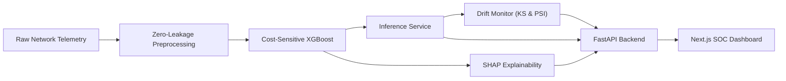

# Adaptive Threat Intelligence

> **An Explainable, Imbalance-Aware and Adaptive Network Intrusion Detection System (NIDS)**  
> Developed for the **DataNova Global Data-thon 2026**

[](https://www.python.org/)
[](LICENSE)
[](https://fastapi.tiangolo.com/)
[](https://nextjs.org/)

---

## 1. Project Overview

**Adaptive Threat Intelligence** is a production-grade Network Intrusion Detection System engineered to address the core challenges of modern Security Operations Centers (SOC):

- **Severe Class Imbalance**: Real-world intrusion signatures occur in fewer than 1-2% of network flows. The system employs cost-sensitive learning formulations and training-isolated rebalancing to minimize False Positive Rates while maximizing high-severity threat recall.
- **Explainable AI (XAI)**: Native SHAP (SHapley Additive exPlanations) TreeExplainer integration decomposes black-box predictions into transparent, per-flow feature attribution rankings for incident responders.
- **Statistical & Concept Drift Detection**: Sliding-window Kolmogorov-Smirnov (KS) tests and Population Stability Index (PSI) algorithms monitor streaming flows to identify adversarial distribution shifts before detection accuracy decays.
- **Strict Scientific Integrity**: Complete architectural isolation of preprocessing, training, evaluation, and inference guarantees zero data leakage and authentic benchmark repeatability.

---

## 2. Monorepo Architecture

```
DataNova/
├── configs/          # Declarative system, model, and logging YAML configurations
├── data/             # Partitioned data tiers (raw, processed, external)
│   ├── raw/          # Immutable, read-only benchmark dumps (excluded from Git)
│   ├── processed/    # Zero-leakage train/validation/test splits
│   └── external/     # Reference protocol and threat intelligence feeds
├── research/         # Research notebooks, ablation experiments, and visualizations
├── ml/               # Core machine learning package
│   ├── preprocessing/# Schema sanitization, cleaning, and zero-leakage splitters
│   ├── features/     # Network flow feature extraction and selection
│   ├── training/     # Imbalance-aware estimators (Cost-sensitive XGBoost)
│   ├── evaluation/   # PR-AUC, cost-weighted metrics, and calibration curves
│   ├── explainability# SHAP explainer bridges and attribution formatters
│   ├── drift/        # Kolmogorov-Smirnov and PSI drift detection engines
│   └── registry/     # Artifact versioning, hash validation, and metadata
├── artifacts/        # Serialized models, evaluation reports, and metric JSONs
├── backend/          # High-performance FastAPI server and SQLite/PostgreSQL ORM
│   └── app/          # API routers, Pydantic schemas, and inference services
├── frontend/         # Next.js 15 (App Router) security analyst dashboard
│   └── src/          # TypeScript components, charts, and telemetry feeds
├── scripts/          # Standalone, repeatable CLI execution utilities
├── tests/            # Pytest test suite (unit, integration, and leakage tests)
└── docs/             # Technical specifications, architecture, and roadmaps
```

For complete architectural specifications, see [docs/architecture.md](docs/architecture.md).

---

## 3. Technology Stack

| Domain | Technologies & Libraries |
| :--- | :--- |
| **Machine Learning** | Python, NumPy, Pandas, Scikit-learn, XGBoost, imbalanced-learn, SHAP, Joblib |
| **Backend & APIs** | FastAPI, Pydantic v2, Uvicorn, SQLAlchemy, SQLite (initial) / PostgreSQL (production) |
| **Frontend UI** | Next.js 15 (App Router), TypeScript (Strict), Tailwind CSS, Recharts, Lucide Icons |
| **Testing & Quality** | Pytest, Pytest-Asyncio, HTTPX, ESLint |
| **Configuration** | PyYAML, Pydantic Settings, Dotenv |

---

## 4. Planned System Workflow



1. **Ingestion & Validation**: Flow data is ingested through historical replay or streaming inputs.
2. **Inference & Scoring**: The serialized pipeline computes threat probabilities using cost-optimized decision thresholds.
3. **Attribution Analysis**: SHAP TreeExplainer generates instance-level feature attributions explaining alert triggers.
4. **Drift Monitoring**: Sliding-window statistics detect covariate shift and alert SOC analysts to traffic profile changes.
5. **Analyst Inspection**: Real-time alerts, attribution charts, and drift metrics are visualized on the Next.js console.

---

## 5. Quickstart & Setup

### 5.1 Environment Prerequisites
- Python 3.11 - 3.13
- Node.js v20+ / v24+
- npm v10+ / v11+
- Git 2.40+

### 5.2 Python Setup
```powershell
# 1. Create and activate virtual environment
python -m venv .venv
.\.venv\Scripts\Activate.ps1   # On Windows
# source .venv/bin/activate    # On Linux/macOS

# 2. Install dependencies
pip install --upgrade pip
pip install -r requirements.txt

# 3. Configure environment
cp .env.example .env

# 4. Run tests
pytest tests/ -v
```

### 5.3 Execution Commands (Planned for Subsequent Phases)
- **Run Backend**: `uvicorn backend.app.main:app --reload --host 127.0.0.1 --port 8000`
- **Run Frontend**: `cd frontend && npm install && npm run dev`
- **Run Preprocessing Pipeline**: `python scripts/run_preprocessing.py --config configs/system_config.yaml`
- **Run Model Training**: `python scripts/train_baseline.py --config configs/system_config.yaml`
- **Run Historical Replay**: `python scripts/run_historical_replay.py --file data/processed/test/flows.parquet`

---

## 6. Core Engineering Principles

1. **Zero Data Leakage**: Transformations and scalers fit exclusively on training partitions. Hold-out test partitions are never touched until final evaluation.
2. **True Imbalance Accounting**: Models optimize for Precision-Recall AUC and operational cost metrics, not deceptively high accuracy.
3. **Transparent Explanations**: Every intrusion detection is accompanied by mathematically grounded SHAP local attributions.
4. **Deterministic Reproducibility**: Fixed random seeds, declarative YAML configs, and model versioning ensure full reproducibility.
5. **No Synthetic Retraining**: Unsupervised feedback loops from unverified predictions are prohibited.
6. **No Fabricated Benchmarks**: Detection claims, metrics, and figures are strictly derived from verified test runs.

---

## 7. Project Status & Roadmap

The project is currently at **Phase 0 (Foundation & Architecture Setup Complete)**.  
See [docs/roadmap.md](docs/roadmap.md) for the phase progression schedule.
