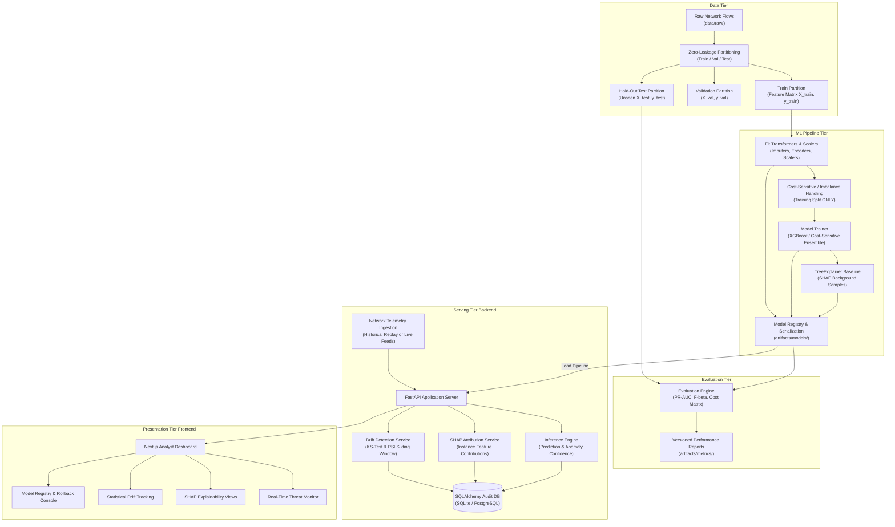

# System Architecture — Adaptive Threat Intelligence

## 1. Executive Summary

**Adaptive Threat Intelligence** is an explainable, imbalance-aware, and adaptive Network Intrusion Detection System (NIDS) designed for enterprise SOC environments and competitive benchmark evaluation in the DataNova Global Data-thon 2026. 

Traditional NIDS deployments face four critical engineering barriers:
1. **Severe Class Imbalance**: Malicious network flows represent less than 1% to 5% of enterprise traffic, rendering vanilla accuracy misleading and standard classifiers prone to excessive false alarms.
2. **The "Black-Box" SOC Deficit**: Security analysts cannot trust or act upon unexplainable alert outputs without understanding *why* a particular flow was classified as an attack.
3. **Statistical & Concept Drift**: Adversaries mutate attack signatures, protocols evolve, and traffic volume fluctuates, resulting in silent model degradation.
4. **Data Leakage & Inadequate Validation**: Academic benchmarks frequently suffer from test set contamination, synthetic oversampling leakage across validation sets, and look-ahead bias.

This project solves these challenges through modular architectural separation, cost-sensitive estimators, integrated SHAP explainability, sliding-window drift detectors, and strict data leakage isolation.

---

## 2. Monorepo Organization & Component Boundaries

The project is structured as a unified monorepo with distinct functional isolation:

```
DataNova/
├── configs/       # Declarative YAML configurations (hyperparameters, drift thresholds)
├── data/          # Raw (read-only), processed, and external reference telemetry
├── research/      # Jupyter exploratory notebooks, ablation studies, and visualizations
├── ml/            # Reusable ML library (preprocessing, features, training, explainability, drift)
├── artifacts/     # Serialized model pipelines, versioned metadata, and evaluation metrics
├── backend/       # FastAPI REST application, WebSocket streaming, and SQLite/PostgreSQL ORM
├── frontend/      # Next.js (App Router) analyst console with Recharts and Tailwind CSS
├── scripts/       # Repeatable automation scripts for pipeline execution and evaluation
├── tests/         # Unit, integration, and leakage validation tests
└── docs/          # Comprehensive design, methodology, and setup documentation
```

---

## 3. System Architecture & Data Flow



---

## 4. Key Subsystem Workflows

### 4.1 Training Pipeline (Zero-Leakage Enforced)
1. **Partitioning**: Split raw tabular flows into Train (65%), Validation (15%), and Test (20%) using stratified sampling. For timestamped data, temporal cutoff splits are supported to avoid look-ahead bias.
2. **Transformer Fitting**: Fit scalers (e.g. `StandardScaler`, `RobustScaler`), imputers, and categorical encoders **strictly on Train**.
3. **Resampling / Weighting**: If synthetic oversampling (e.g. SMOTE) is evaluated, it is applied **exclusively on the training split**. The validation and test sets remain pristine, representing real-world distribution.
4. **Model Training**: Fit XGBoost with cost-sensitive `scale_pos_weight` and custom objective/evaluation metrics focusing on PR-AUC.
5. **Explainer Initialization**: Compute background SHAP summaries from representative training clusters.
6. **Artifact Bundle**: Package the preprocessor pipeline, trained estimator, explainer baseline, and feature schema into a versioned bundle in `artifacts/models/`.

### 4.2 Inference Pipeline
1. Incoming telemetry (single record or mini-batch) arrives at the `/api/v1/predict` endpoint.
2. The preprocessor applies the frozen, serialized transformation without retraining or dynamic recalibration.
3. The estimator predicts class probabilities $P(\text{Attack} \mid X)$.
4. Classification decisions apply an operational threshold $\tau$ optimized for minimal business cost:
   $$\text{Decision} = \begin{cases} \text{Attack}, & P(\text{Attack} \mid X) \ge \tau \\ \text{Benign}, & P(\text{Attack} \mid X) < \tau \end{cases}$$
5. An inference audit log is committed to the database.

### 4.3 Explainability Pipeline (SHAP Integration)
1. For every detected threat (or on-demand analyst request), the backend invokes `TreeExplainer` on the transformed flow vector.
2. SHAP values $\phi_i$ are computed for each feature:
   $$f(x) = \phi_0 + \sum_{i=1}^M \phi_i(x)$$
3. The top-$k$ influential features (positive push toward Attack, negative push toward Benign) are extracted.
4. The API returns local feature contributions, allowing SOC analysts to instantly inspect which flow parameters (e.g., abnormally high `Flow_Bytes_s` or irregular TCP window sizes) caused the alarm.

### 4.4 Adaptive Drift Detection & Feedback Cycle
1. The inference engine maintains a sliding window of recent telemetry (e.g., $N=1,000$ to $5,000$ flows).
2. Continuous features are tested against baseline distributions using the two-sample **Kolmogorov-Smirnov (KS) test**:
   $$D = \sup_x |F_{\text{ref}}(x) - F_{\text{recent}}(x)|$$
3. Categorical and binned distributions are monitored using the **Population Stability Index (PSI)**:
   $$\text{PSI} = \sum \left( \text{Actual}\% - \text{Expected}\% \right) \times \ln\left(\frac{\text{Actual}\%}{\text{Expected}\%}\right)$$
4. When $\text{PSI} > 0.25$ or $p < 0.05$ across critical features, a `DRIFT_ALERT` is triggered.
5. **Retraining Guardrail**: Drift alerts notify ML engineers and trigger automated benchmark re-validation against verified ground-truth holdouts. The system **never** performs automatic unsupervised retraining on unverified live predictions.

### 4.5 Historical Replay vs. Live Monitoring
- **Historical Dataset Replay**: A dedicated simulation runner reads chronological hold-out records from `data/processed/test/` and replays them via HTTP/WebSocket into the backend API at controlled playback speeds (1x, 5x, 10x). This allows deterministic reproduction of past incidents.
- **Live Network Monitoring**: Real-time traffic captured via flow probes or packet capture daemons (e.g. Zeek/Suricata/tshark flow logs). The backend treats replay and live traffic identically via standardized REST/WebSocket contracts, but records the ingestion source explicitly in the audit log.

---

## 5. Engineering Guardrails & Leakage Prevention

| Mechanism | Implementation Detail |
| :--- | :--- |
| **Partition Isolation** | Dataset splits are computed first. Split index masks are stored to ensure reproducible, non-overlapping partitions. |
| **Pipeline Encapsulation** | Preprocessing, feature transforms, and model estimation are chained in unified `sklearn.pipeline.Pipeline` or custom frozen container objects. |
| **Imbalance Integrity** | SMOTE, class weighting, or undersampling are restricted exclusively to training sets. Evaluation sets retain pure empirical ratios. |
| **Metric Appropriateness** | Accuracy is prohibited as an evaluation metric. Models are assessed on Precision-Recall Curves (PR-AUC), F1-macro, and expected cost loss. |
| **Model Versioning** | Models are tagged with semver, commit SHA, and training data hash. Rollback capability is built into the model registry service. |
