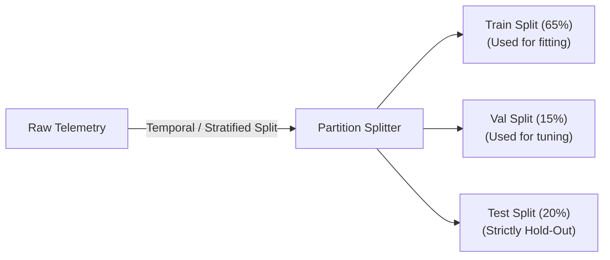

# Scientific & Engineering Methodology

## 1. Problem Formulation

Network Intrusion Detection Systems (NIDS) aim to classify individual packet flows $\mathbf{x} \in \mathbb{R}^d$ into normal traffic ($y = 0$, Benign) or cyberattacks ($y = 1$, Attack), or into multi-class attack categories (e.g. DoS, PortScan, BruteForce, Botnet, Infiltration).

In realistic operational networks:
- Class imbalance is extreme: $P(y = 1) \ll P(y = 0)$ (typically $< 2\%$).
- Attack patterns evolve rapidly, introducing covariate shift $P(\mathbf{x})$ and concept drift $P(y \mid \mathbf{x})$.
- False alarms waste critical human analyst hours, while false negatives cause security disasters.

---

## 2. Leakage-Free Data Protocol

### 2.1 Partitioning Strategy
Data partitioning must strictly occur before any descriptive statistics, imputation parameters, scaling factors, or resamplers are computed.

1. **Temporal Cutoff vs. Stratified Splitting**: When timestamps exist, chronological ordering avoids look-ahead leakage. When timestamps are missing or synthetic, stratified splitting guarantees uniform representation of minority attack categories across partitions.
2. **Identifier Elimination**: Identifiers such as IP addresses (`Source_IP`, `Destination_IP`), MAC addresses, and flow session IDs are excluded from feature matrices to prevent the model from memorizing specific network topologies rather than learning behavioral flow dynamics.
3. **Resampling Guardrail**: Synthetic minority oversampling (e.g. SMOTE) is applied **only to the training set**. The validation and test sets remain unaltered to reflect true operational prevalence.

---

## 3. Imbalance-Aware Loss & Evaluation

### 3.1 Metric Inadequacy of Standard Accuracy
Under a 99:1 benign-to-attack imbalance, a trivial majority-class classifier achieves 99% accuracy while detecting 0 attacks. Accuracy is therefore banned from model evaluation.

### 3.2 Evaluation Suite
- **Precision-Recall AUC (PR-AUC)**: Focuses directly on minority class detection without inflation by high true negative counts.
- **Cost-Weighted Expected Loss ($L_{\text{cost}}$)**:
  $$L_{\text{cost}} = C_{\text{FP}} \cdot \text{FP} + C_{\text{FN}} \cdot \text{FN}$$
  where $C_{\text{FN}} \gg C_{\text{FP}}$ (e.g., $C_{\text{FN}} = 20$, $C_{\text{FP}} = 1$).
- **False Alarm Rate (FAR / FPR)**:
  $$\text{FAR} = \frac{\text{FP}}{\text{FP} + \text{TN}}$$
  Operational goal: Maintain FAR $< 0.5\%$ while maximizing Attack Recall.
- **F-beta Score ($\beta = 2$)**: Weights recall higher than precision to prioritize breach detection.

---

## 4. Explainable AI via SHAP

Black-box models hinder incident triage. We integrate TreeSHAP for tree-based models, computing exact Shapley values grounded in cooperative game theory:

$$\phi_i(x) = \sum_{S \subseteq F \setminus \{i\}} \frac{|S|!(|F| - |S| - 1)!}{|F|!} \left[ f(S \cup \{i\}) - f(S) \right]$$

### Operational Output
For each suspicious flow, the backend extracts:
- Base expected value $\mathbb{E}[f(x)]$.
- Model log-odds prediction $f(x)$.
- Top-$k$ contributing features with signed magnitude:
  - $\phi_i > 0$: Features increasing the probability of intrusion (e.g. elevated `Fwd_Packets_s`, anomalous `Init_Win_Bytes_Backward`).
  - $\phi_i < 0$: Features pushing toward benign behavior.

---

## 5. Statistical Drift Detection

Continuous monitoring over a sliding window $W_t = \{x_{t-N+1}, \dots, x_t\}$ against a fixed baseline reference distribution $W_{\text{ref}}$.

### 5.1 Two-Sample Kolmogorov-Smirnov (KS) Test
For continuous flow features (e.g., flow duration, bytes per second, packet length variance):
$$D = \sup_{u} |F_{W_t}(u) - F_{W_{\text{ref}}}(u)|$$
A drift warning is triggered when the test p-value falls below $\alpha = 0.05$.

### 5.2 Population Stability Index (PSI)
For binned numerical or categorical attributes:
$$\text{PSI} = \sum_{b=1}^B \left( P_t(b) - P_{\text{ref}}(b) \right) \times \ln\left( \frac{P_t(b)}{P_{\text{ref}}(b)} \right)$$
- $\text{PSI} < 0.10$: Negligible shift.
- $0.10 \le \text{PSI} < 0.25$: Moderate drift (warning triggered, review recommended).
- $\text{PSI} \ge 0.25$: Significant distribution shift (drift alert triggered).

---

## 6. Reproducibility & Governance Rules

- All random states are seeded with `SEED = 42`.
- Models are tracked with deterministic hash tags, training configurations, and frozen artifact manifests.
- Unsupervised retraining from unverified model outputs is prohibited to prevent adversarial poisoning and feedback loops.
