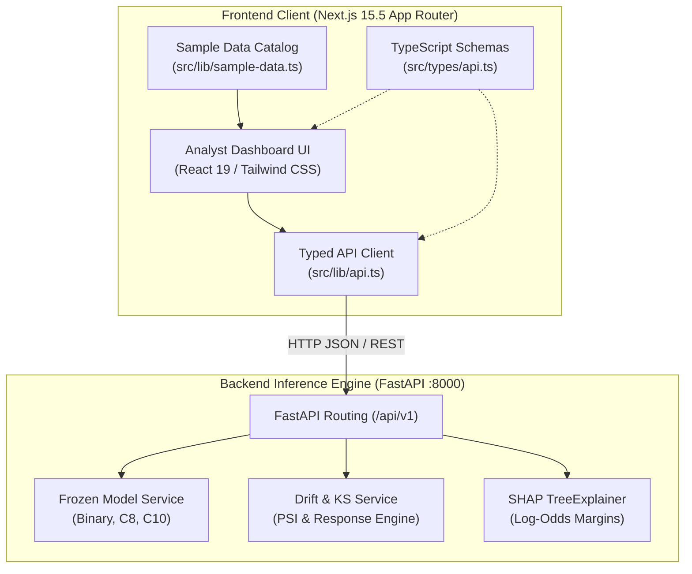

# Phase 8A — Frontend Foundation & API Integration Completion Report

**Project:** Adaptive Threat Intelligence — DataNova Global Data-thon 2026  
**Phase:** Phase 8A (Frontend Foundation & API Integration)  
**Status:** Complete & Verified (Ready for Review)  
**Backend Status:** Healthy (79/79 tests passed, 0 warnings)  
**Frontend Status:** Build Passed (`tsc --noEmit` & `next build` with 0 errors)  
**Git Baseline:** Commit `57abb41` (Phase 7 freeze); Phase 8 changes uncommitted.

---

## 1. Executive Summary

Phase 8A establishes the analyst-facing UI architecture for the DataNova NIDS platform, bridging the frozen research pipeline and FastAPI backend with a type-safe, high-performance web console.

All 9 FastAPI endpoints are mapped to TypeScript interfaces and wrapped in a client service with typed error propagation. The application shell provides a navigation hierarchy, real-time backend connectivity monitoring, and an Overview dashboard that inspects model registry metadata, training reference invariants, and system memory.



---

## 2. Implemented Components & Architecture

### 2.1 Technology Stack & Toolchain
- **Framework:** Next.js 15.5.29 (App Router)
- **UI Runtime:** React 19.1.0 with StrictMode enabled
- **Styling:** Tailwind CSS 3.4.17 with `@tailwindcss/forms` and `autoprefixer`
- **Icons:** Lucide React 0.507.0
- **Visualization:** Recharts 2.15.1
- **TypeScript:** TypeScript 5.8.2 (`strict: true`, `noImplicitAny: true`, `noUnusedLocals: true`)

### 2.2 TypeScript API Contracts ([api.ts](file:///C:/Users/Chirag/Desktop/DataNova/frontend/src/types/api.ts))
Complete bidirectional contract alignment with FastAPI Pydantic schemas:
- `NetworkFlowRecord`: Exact 42 UNSW-NB15 input predictor schema with non-finite validation.
- `BinaryPredictionRequest` & `BinaryPredictionResponse`: Prediction labels, probabilities, calibrated operating thresholds, and margin indicators.
- `MulticlassPredictionRequest` & `MulticlassPredictionResponse`: Candidate selection (`candidate8_primary` vs `candidate10_no_sttl`), 10-family probabilities, and SOC escalation flags.
- `ModelComparisonRequest` & `ModelComparisonResponse`: Side-by-side C8 vs C10 comparison, agreement flags, and probability divergence.
- `DriftMonitoringRequest` & `DriftMonitoringResponse`: Feature-level PSI/KS metrics, missing value rates, prediction distribution divergence, and adaptive response recommendations.
- `ExplainRequest` & `ExplainResponse`: SHAP waterfall metrics, raw log-odds margins, explained class identifiers, and original raw feature aggregations.
- `HealthResponse`, `SystemStatusResponse`, `ModelsListResponse`, `ModelInfo`, and `ApiErrorResponse`.

### 2.3 Typed API Client ([api.ts](file:///C:/Users/Chirag/Desktop/DataNova/frontend/src/lib/api.ts))
- Configurable base URL via `NEXT_PUBLIC_API_URL` (defaulting to `http://127.0.0.1:8000`).
- Typed custom error handler `ApiError` extracting detail strings or structured validation errors.
- Clean functional methods covering all 9 backend endpoints:
  - `getHealth()`, `getSystemStatus()`, `getModels()`
  - `predictBinary()`, `predictMulticlass()`, `compareModels()`
  - `monitorDrift()`, `explainFlows()`

### 2.4 Pre-Loaded Flow Catalog ([sample-data.ts](file:///C:/Users/Chirag/Desktop/DataNova/frontend/src/lib/sample-data.ts))
Curated, valid UNSW-NB15 flow telemetry samples for rapid analyst testing without requiring manual JSON entry:
- `SAMPLE_BENIGN_FLOW`: Legitimate DNS session (`proto: udp`, `service: dns`, `state: CON`).
- `SAMPLE_EXPLOIT_FLOW`: Exploits network flow vector (`proto: tcp`, `service: http`, `sttl: 31`).
- `SAMPLE_DOS_FLOW`: High-rate Denial of Service flow (`proto: tcp`, `dur: 0.000003`, `sbytes: 140`).

### 2.5 Application Shell & Layout
- **Sidebar ([sidebar.tsx](file:///C:/Users/Chirag/Desktop/DataNova/frontend/src/components/layout/sidebar.tsx)):** Persistent left navigation bar with 5 specialized analyst workspaces:
  1. *Overview* (`/`): Health, telemetry, model inventory.
  2. *Traffic Analysis* (`/traffic`): Single-flow and batch CSV prediction.
  3. *Explainability Lab* (`/explainability`): SHAP local feature attributions.
  4. *Drift Monitor* (`/drift`): PSI, KS tests, and adaptive engine recommendations.
  5. *Model Laboratory* (`/models`): Candidate 8 vs Candidate 10 side-by-side audit.
- **Header ([header.tsx](file:///C:/Users/Chirag/Desktop/DataNova/frontend/src/components/layout/header.tsx)):** Global top bar with live 30-second polling health badge, active models indicator, and research benchmark disclaimer.
- **Root Layout ([layout.tsx](file:///C:/Users/Chirag/Desktop/DataNova/frontend/src/app/layout.tsx)):** App Router layout providing clean flexbox shell and Inter font styling.

### 2.6 Overview Dashboard ([page.tsx](file:///C:/Users/Chirag/Desktop/DataNova/frontend/src/app/page.tsx))
Provides complete visibility into the runtime environment:
- **System Telemetry KPIs:** Live inference service status, number of loaded model artifacts, reference dataset row count (151,325 rows), and process RSS memory footprint.
- **Model Registry Table:** Full inventory of serialized artifacts (`binary_classifier`, `candidate8_primary`, `candidate10_no_sttl`), feature schemas (42 vs 41 features), task types, and calibrated operating points.
- **Data Partition & Integrity Assurance:** Explicitly surfaces test set partition isolation, read-only joblib storage, and non-destructive adaptive response safeguards.
- **Quick Action Navigation Cards:** Direct entry points to Traffic Analysis, Explainability Lab, Drift Monitor, and Model Laboratory.

---

## 3. Verification & Validation Results

### 3.1 Static Typing & Compilation
- `npm run typecheck` (`tsc --noEmit`): **PASSED** (0 errors).
- `npm run build` (`next build`): **PASSED** (Static route compilation, 113 kB first-load JS, 0 errors).

```
Route (app)                                 Size  First Load JS
┌ ○ /                                    4.25 kB         113 kB
└ ○ /_not-found                            993 B         104 kB
+ First Load JS shared by all             103 kB
  ├ chunks/255-73938ce8a8eac1ad.js       46.6 kB
  ├ chunks/4bd1b696-c023c6e3521b1417.js  54.2 kB
  └ other shared chunks (total)          1.99 kB

○  (Static)  prerendered as static content
```

### 3.2 Backend Regression Test Suite
Execution of `python -m pytest tests/ backend/tests/ -v`:
- **Result:** **79 / 79 tests passed** in 23.26s.
- **Warnings:** 0 warnings.
- **Model Immutability:** Confirmed frozen memory state; zero model corruption or threshold drift.

---

## 4. Work Tree State & Guardrails

- **Git HEAD:** `57abb41` (Phase 7 final commit).
- **Branch:** `main` (clean local history, zero remote pushes).
- **Working Tree:** All Phase 8A additions remain intentionally untracked/unstaged until full Phase 8 review and approval.
- **Guardrails Observed:**
  - Tabular flow telemetry analysis only (no raw PCAP or sniffing daemons).
  - No silent retraining, parameter mutation, or automated pipeline updates.
  - Research benchmark context preserved across all UI views.

---

## 5. Next Steps — Phased Execution Roadmap

With the Phase 8A foundation verified, subsequent modules will be delivered incrementally:

1. **Phase 8B — Traffic Analysis:**
   - Single flow prediction interface with preset selector (`SAMPLE_FLOW_CATALOG`) and form inputs.
   - Batch CSV file uploader with preview table and schema validation.
   - Dual-mode prediction: Binary detection (with threshold presets) and Multiclass classification (with C8/C10 selector).
   - Results presentation with probability breakdown, risk level, and SOC escalation badges.
2. **Phase 8C — Explainability Lab & Model Laboratory:**
   - Interactive SHAP waterfall and attribution bar charts in raw log-odds margins.
   - Aggregated parent feature vs one-hot encoded breakdown.
   - Side-by-side C8 vs C10 prediction comparison and probability divergence visualization.
3. **Phase 8D — Drift Monitor:**
   - Distribution drift dashboard with feature PSI bar charts and KS test significance tables.
   - Data quality metrics (missing rate, non-finite values, category shift).
   - Adaptive decision engine recommendations card (`NO_ACTION`, `SWITCH_TO_NO_STTL`, `FLAG_AFFECTED_FEATURES`, `COLLECT_RETRAINING_DATA`).
4. **Phase 8E — End-to-End Integration, QA & Final Phase 8 Freeze:**
   - Comprehensive multi-browser/responsive audit.
   - Final report compilation (`research/reports/phase8_analyst_dashboard_report.md`).
   - Dedicated local commit for Phase 8.
