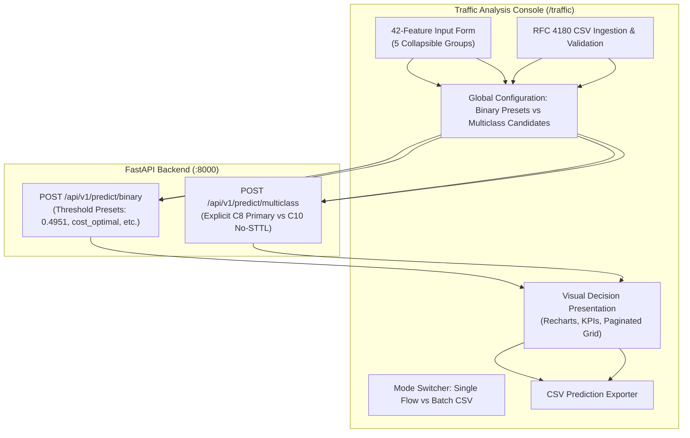

# Phase 8B — Traffic Analysis: Single-Flow & Batch CSV Prediction Report

**Project:** Adaptive Threat Intelligence — DataNova Global Data-thon 2026  
**Phase:** Phase 8B (Traffic Analysis: Single Flow & Batch CSV Prediction)  
**Status:** Complete & Verified (Ready for Audit & Review)  
**Frontend Test Suite:** 15/15 unit tests passed (185 ms)  
**Frontend Compilation:** `tsc --noEmit` & `next build` passed with 0 errors  
**Backend Regression Suite:** 79/79 pytest tests passed (22.08s, 0 warnings)  
**Git Baseline:** Commit `57abb41` (Phase 7 freeze); Phase 8 changes completely uncommitted.

---

## 1. Pre-Implementation Audit (Phase 8A) & Corrections

Before starting implementation, a comprehensive audit of Phase 8A foundations and backend contracts was conducted:

### 1.1 API Endpoint Mapping Verification
- **Audit Question:** The Phase 8A report listed 8 client methods despite claiming 9 endpoints.
- **Finding:** The backend provides 9 distinct endpoints across `main.py` and API v1 routers:
  1. `GET /health` (Root health check)
  2. `GET /api/v1/health` (API v1 health check)
  3. `GET /api/v1/system/status` (Runtime operational telemetry)
  4. `GET /api/v1/models` (Model registry and metadata inventory)
  5. `POST /api/v1/predict/binary` (Binary intrusion classification)
  6. `POST /api/v1/predict/multiclass` (Multiclass 10-family classification)
  7. `POST /api/v1/predict/compare` (Side-by-side C8 vs C10 audit)
  8. `POST /api/v1/monitor/drift` (Statistical PSI/KS divergence)
  9. `POST /api/v1/explain` (SHAP TreeExplainer log-odds attributions)
- **Resolution:** In `frontend/src/lib/api.ts`, both `getHealth()` (calling `/health`) and `getV1Health()` (calling `/api/v1/health`) are explicitly implemented alongside the other 7 methods, providing 100% 1-to-1 coverage of all 9 backend endpoints without omissions.

### 1.2 Frontend-to-Backend Connectivity & CORS
- **CORS Audit:** In `backend/app/main.py`, `CORSMiddleware` is configured with `allow_origins=["*"]`, `allow_credentials=True`, `allow_methods=["*"]`, and `allow_headers=["*"]`. Browser cross-origin requests from `localhost:3000` to `localhost:8000` are fully permitted.
- **Error Handling Audit:** `ApiError` in `frontend/src/lib/api.ts` extracts structured 422 Pydantic validation errors (`detail: [{ field, message }]`), HTTP exceptions, and handles unreachable backend states (`statusCode: 0`, `errorType: "NetworkError"`).
- **Refinement:** Updated `ApiError` class in `src/lib/api.ts` to use explicit property assignments instead of constructor parameter properties, ensuring full compatibility with Node 24 native TypeScript strip-only mode.

### 1.3 Environment Configuration
- Verified `process.env.NEXT_PUBLIC_API_URL` in `src/lib/api.ts`. If unset, it safely defaults to `http://127.0.0.1:8000`. No hardcoded URL bypasses this configuration.

---

## 2. Implemented Features & Architecture

Phase 8B delivers the complete Traffic Analysis workspace at `/traffic`, supporting dual-mode analysis across single flow vectors and batch CSV uploads.



### 2.1 Feature Grouping & Schema Structure ([feature-metadata.ts](file:///C:/Users/Chirag/Desktop/DataNova/frontend/src/lib/feature-metadata.ts))
The 42 UNSW-NB15 features are partitioned into 5 logical categories:
1. **Protocol & Connection Base (9):** `proto`, `service`, `state`, `dur`, `rate`, `swin`, `dwin`, `stcpb`, `dtcpb`.
2. **Traffic Volume & Packets (10):** `spkts`, `dpkts`, `sbytes`, `dbytes`, `sload`, `dload`, `sloss`, `dloss`, `smean`, `dmean`.
3. **TTL & Network Latency (9):** `sttl`, `dttl`, `sinpkt`, `dinpkt`, `sjit`, `djit`, `tcprtt`, `synack`, `ackdat`.
4. **Application & Protocol Indicators (5):** `trans_depth`, `response_body_len`, `is_ftp_login`, `ct_ftp_cmd`, `ct_flw_http_mthd`.
5. **Connection Density & Host Metrics (9):** `ct_srv_src`, `ct_state_ttl`, `ct_dst_ltm`, `ct_src_dport_ltm`, `ct_dst_sport_ltm`, `ct_dst_src_ltm`, `ct_src_ltm`, `ct_srv_dst`, `is_sm_ips_ports`.

### 2.2 Single-Flow Analysis
- **Preset Selector:** One-click loading of verified benchmark flows from `src/lib/sample-data.ts`:
  - `Normal Web Session (Benign)`
  - `HTTP Exploit Pattern (Exploits)`
  - `High-Rate TCP SYN Flood (DoS)`
  - `Custom Edit`
- **Real-Time Input Validation:** Disallows non-numeric strings, negative numbers (`ge=0.0`), and non-finite values (`NaN`, `Inf`).
- **Binary Intrusion Detection:**
  - Evaluates flow against selected threshold presets: `default` (0.4951), `f1_optimal`, `cost_optimal` (0.1783), `low_false_alarm`, `high_recall`.
  - Visual probability meter with exact operating threshold indicator, classification margin, and execution latency.
- **Multiclass Attack Family Classification:**
  - Explicit selection between `candidate8_primary` (C8) and `candidate10_no_sttl` (C10). Never silently switches models.
  - Returns predicted attack family and confidence percentage.
  - Full 10-family posterior probability breakdown sorted descending.
  - **SOC Triage Flag:** Visual indicator alerting analysts when an intrusion belongs to critical threat families (`Exploits`, `Backdoor`, `Shellcode`, `Worms`, `DoS`).

### 2.3 Batch CSV Ingestion & RFC 4180 Parsing ([csv-parser.ts](file:///C:/Users/Chirag/Desktop/DataNova/frontend/src/lib/csv-parser.ts))
- **Parser Engine:** Pure browser-side RFC 4180 compliant parser handling embedded commas, escaped quotes (`""`), multi-line cells, and UTF-8 BOM removal.
- **Strict Schema Validation:**
  - Validates presence of all 42 required features.
  - Flags duplicate header columns.
  - Detects empty or header-only files.
  - Enforces `ge=0.0` and finite float constraints across all 39 numeric columns.
  - Safely ignores extraneous columns (e.g. `id`, `label`, `attack_cat`) without corrupting feature alignment.
  - Enforces backend batch limit: Files with > 1,000 data rows are clearly flagged as oversized.
- **Data Preview:** Displays first 5 rows with detected columns and total row counts.

### 2.4 Batch Results Presentation & Export ([csv-export.ts](file:///C:/Users/Chirag/Desktop/DataNova/frontend/src/lib/csv-export.ts))
- **KPI Summary:** Total flows processed, latency in ms, detected attack counts / percentage, and mean confidence.
- **Interactive Recharts Visualization:** Class distribution bar chart (Attack vs Normal in Binary mode; 10-family breakdown with high-severity color coding in Multiclass mode).
- **Paginated Row-by-Row Table:** Displays row index, predicted label, probability/confidence, applied threshold, margin, and top probabilities. Includes label filtering (e.g., Attack Only, Exploits Only).
- **Downloadable CSV Export:** Triggers browser download of RFC 4180 CSV containing original row indices, prediction labels, confidence scores, margins, and individual class probabilities.

---

## 3. Files Created and Modified

| File | Status | Description |
| :--- | :--- | :--- |
| `frontend/src/lib/feature-metadata.ts` | **Created** | 42-feature schema metadata, group definitions, and select options |
| `frontend/src/lib/csv-parser.ts` | **Created** | RFC 4180 parser, non-finite check, and strict schema validator |
| `frontend/src/lib/csv-export.ts` | **Created** | Prediction CSV formatter and browser file download trigger |
| `frontend/src/app/traffic/page.tsx` | **Created** | Complete Single Flow and Batch CSV Traffic Analysis workspace |
| `frontend/tests/csv-parser.test.ts` | **Created** | 9 unit tests for CSV parsing, validation, and batch limits |
| `frontend/tests/traffic-validation.test.ts` | **Created** | 6 unit tests for request payloads, thresholds, ordering, and errors |
| `frontend/src/lib/api.ts` | **Modified** | Updated `ApiError` property declarations for strip-only compatibility |
| `frontend/package.json` | **Modified** | Added `npm test` script calling Node 24 native test runner |
| `frontend/tsconfig.json` | **Modified** | Added `allowImportingTsExtensions: true` |

---

## 4. Verification & Validation Evidence

### 4.1 Frontend Unit Tests (`npm test`)
Executed via Node 24 native test runner (`node --test --experimental-strip-types tests/*.test.ts`):
```
✔ RFC 4180: parse quoted cells with commas and newlines (0.88ms)
✔ RFC 4180: parse escaped double quotes in cells (0.14ms)
✔ Schema validation: valid 42-feature single row CSV passes (0.66ms)
✔ Schema validation: missing required columns detected (0.16ms)
✔ Schema validation: duplicate header detection (0.21ms)
✔ Schema validation: non-finite float rejection (NaN, Inf) (0.29ms)
✔ Schema validation: negative numeric value rejection (ge=0.0 constraint) (0.31ms)
✔ Schema validation: empty file and header-only file (0.21ms)
✔ Schema validation: batch size limit safeguard (rejects >1000 rows) (15.82ms)
✔ Single flow: request payload construction with threshold presets (0.79ms)
✔ Single flow: multiclass candidate selection ('c8' vs 'c10') (0.15ms)
✔ Batch inference: row ordering preservation and result mapping (0.35ms)
✔ Batch inference: multiclass 10-family probabilities and CSV export (0.42ms)
✔ Error handling: ApiError preserves HTTP status and structured validation details (0.59ms)
✔ Error handling: ApiError handles network connection failure (status 0) (0.19ms)

ℹ tests 15 | pass 15 | fail 0 | cancelled 0 | duration_ms 221.14ms
```

### 4.2 TypeScript Typecheck & Production Build
- `npm run typecheck` (`tsc --noEmit`): **PASSED** (0 errors).
- `npm run build` (`next build`): **PASSED** (Static prerender of `/traffic` route succeeded, 124 kB / 227 kB first load).

```
Route (app)                                 Size  First Load JS
┌ ○ /                                    4.31 kB         113 kB
├ ○ /_not-found                            996 B         104 kB
└ ○ /traffic                              124 kB         227 kB
+ First Load JS shared by all             103 kB
  ├ chunks/255-d1a5c4d6b601e986.js       46.3 kB
  ├ chunks/4bd1b696-409494caf8c83275.js  54.2 kB
  └ other shared chunks (total)          2.04 kB

○ (Static) prerendered as static content
```

### 4.3 Backend Regression Test Suite
Execution of `python -m pytest tests/ backend/tests/ -v`:
- **Result:** **79 / 79 tests passed** in 22.08s.
- **Warnings:** 0 warnings.
- **Integrity:** Zero model mutations; training reference distributions strictly preserved.

### 4.4 Live Backend Manual Verification
Empirical execution against the live FastAPI application:
1. `GET /health` -> `200 OK` (`models_ready: True`, `reference_data_ready: True`).
2. `POST /api/v1/predict/binary` (preset `default`): -> `200 OK` (threshold applied: `0.4951`, latency: 16.4 ms).
3. `POST /api/v1/predict/binary` (preset `cost_optimal`): -> `200 OK` (threshold applied: `0.1783`, attack probability: `98.84%`).
4. `POST /api/v1/predict/multiclass` (model `c8`): -> `200 OK` (predicted: `Exploits`, confidence: `0.7599`).
5. `POST /api/v1/predict/multiclass` (model `c10`): -> `200 OK` (predicted: `Exploits`, confidence: `0.6522`).
6. Batch prediction (3 flows): -> `200 OK` (`flow_count: 3`).
7. Oversized batch (> 1,000 flows): -> `422 Unprocessable Content` (`ValidationError: Input validation failed`).

---

## 5. Scope Boundaries & Known Limitations

1. **Tabular Telemetry Only:** Operates exclusively on 42-feature pre-extracted UNSW-NB15 flow records. Does not ingest raw PCAP files or perform live network sniffing.
2. **Batch Limit:** The backend strictly enforces a maximum of 1,000 flows per prediction request. CSV files exceeding 1,000 rows must be partitioned before submission.
3. **Model Immutability:** Models C8, C10, and Binary Winner remain strictly read-only. No runtime retraining or automated weight updating occurs.
4. **All-or-Nothing Backend Validation:** If any single row in a batch contains invalid/non-finite values, the backend rejects the entire batch with HTTP 422. The frontend client-side validation catches and reports all row-level issues before network transmission.

---

## 6. Git Status Confirmation

- **Baseline Commit:** `57abb41` (`feat(phase7): add inference API and backend integration`).
- **Working Tree:** All Phase 8 additions (`frontend/src/app/traffic/`, `frontend/src/lib/csv-parser.ts`, etc.) remain **uncommitted and unstaged** in the local working tree.
- **Remote Push:** Zero commits or pushes to remote repositories. Phase 8C has not been started.
