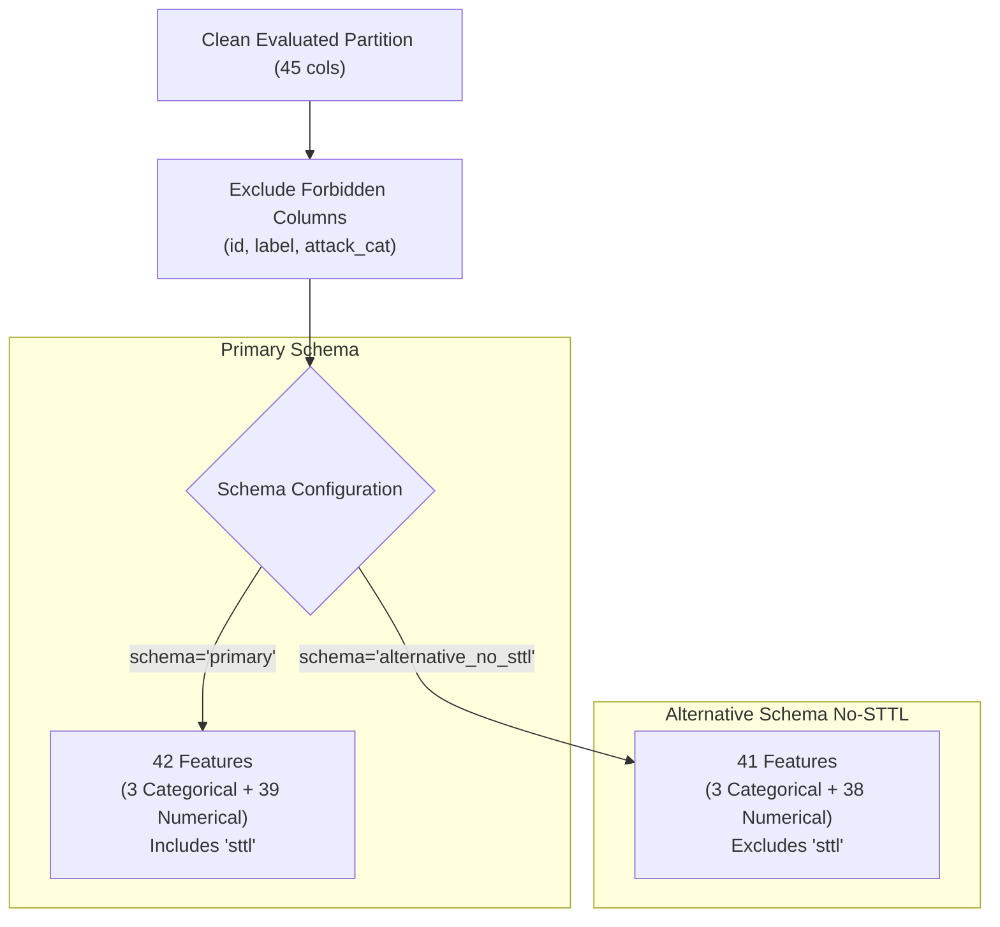
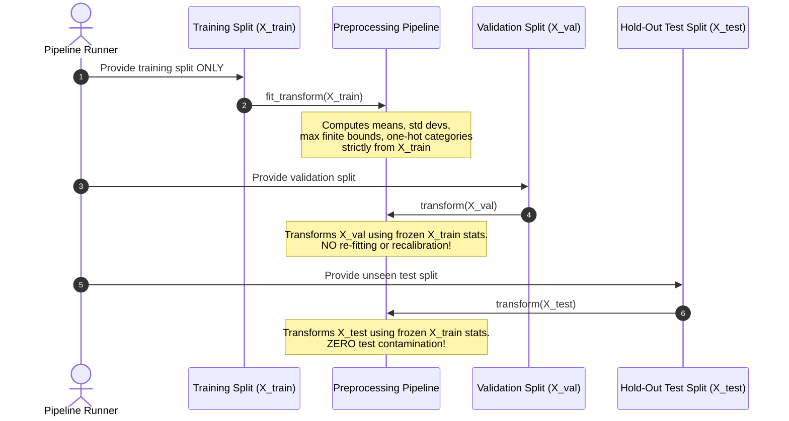

# Preprocessing Pipeline Architecture & Leakage Safeguards Report

**Project**: Adaptive Threat Intelligence  
**Phase**: Phase 2 — Preprocessing Infrastructure Design  
**Date**: October 2026  

---

## 1. Executive Summary

This report documents the modular, zero-leakage preprocessing architecture implemented in `ml/preprocessing/`. The pipeline handles numerical feature scaling, infinite value clipping, categorical one-hot encoding, unknown protocol handling, and dual-schema comparison (Primary vs. No-STTL).

---

## 2. Feature Boundaries & Schema Formulations

### 2.1 Forbidden Columns
To prevent target and metadata leakage, the following columns are strictly excluded from all predictor matrices:
1. `id`: Sequential identifier exhibiting $r = +0.7272$ target correlation.
2. `label`: Binary target (excluded when predicting `attack_cat`).
3. `attack_cat`: Multiclass target (excluded when predicting `label`).
4. `origin_split` / row numbers: Meta-annotations.

### 2.2 Dual Feature Schemas

#### Primary Schema (42 Predictor Features)
- **Categorical (3)**: `proto`, `service`, `state`.
- **Numerical (39)**: `dur`, `spkts`, `dpkts`, `sbytes`, `dbytes`, `rate`, `sttl`, `dttl`, `sload`, `dload`, `sloss`, `dloss`, `sinpkt`, `dinpkt`, `sjit`, `djit`, `swin`, `stcpb`, `dtcpb`, `dwin`, `tcprtt`, `synack`, `ackdat`, `smean`, `dmean`, `trans_depth`, `response_body_len`, `ct_srv_src`, `ct_state_ttl`, `ct_dst_ltm`, `ct_src_dport_ltm`, `ct_dst_sport_ltm`, `ct_dst_src_ltm`, `is_ftp_login`, `ct_ftp_cmd`, `ct_flw_http_mthd`, `ct_src_ltm`, `ct_srv_dst`, `is_sm_ips_ports`.

#### Alternative Schema: No-STTL (41 Predictor Features)
- Omits the `sttl` (Source Time-To-Live) feature.
- **Scientific Rationale**: Phase 1 discovered that `sttl == 31` accounts for 16,702 flows that are 100% Benign, while `sttl == 254` accounts for 39,000 flows (86% of all attacks). This bimodal distribution reflects default operating system configurations in the IXIA PerfectStorm generator rather than genuine behavioral attack dynamics.
- **Phase 3 Experimentation Plan**: In Phase 3, we will benchmark baseline and advanced models on both schemas to empirically measure the "STTL performance gap". If accuracy collapses without `sttl`, the model was merely memorizing simulator defaults; if performance remains robust, the model learned genuine attack behavior.

---

## 3. Preprocessing Transformations & Unknown Category Safeguards

### 3.1 Numerical Sub-Pipeline
1. **`InfClipper`**: Network traffic features frequently record infinite values when flow durations approach zero during rate computations (e.g. `rate`, `sload`, `dload`). `InfClipper` fits the maximum and minimum finite values strictly on the training partition and caps infinite values at test/inference time.
2. **`StandardScaler` / `RobustScaler`**: Standardizes zero mean and unit variance. `RobustScaler` (interquartile range) is supported as a pluggable alternative to mitigate heavy-tailed packet size outliers.

### 3.2 Categorical Sub-Pipeline
1. **`OneHotEncoder(handle_unknown='ignore', sparse_output=False)`**:
   - The test set contains novel protocols (`icmp`, `rtp`) and novel states (`no`, `PAR`, `URN`, `ECO`) not present in the training set.
   - Using `handle_unknown='ignore'` assigns all-zero vectors to novel categories at inference time, preventing runtime exceptions while preserving numerical stability.

---

## 4. Zero Data Leakage Enforcement Protocol

### Protocol Invariants
1. **No Global Transformation**: Transforming or fitting before splitting is strictly prohibited and enforced via automated test assertions.
2. **Frozen Artifacts**: The fitted preprocessor bundle is saved alongside model weights into `artifacts/models/` for downstream backend serving.
